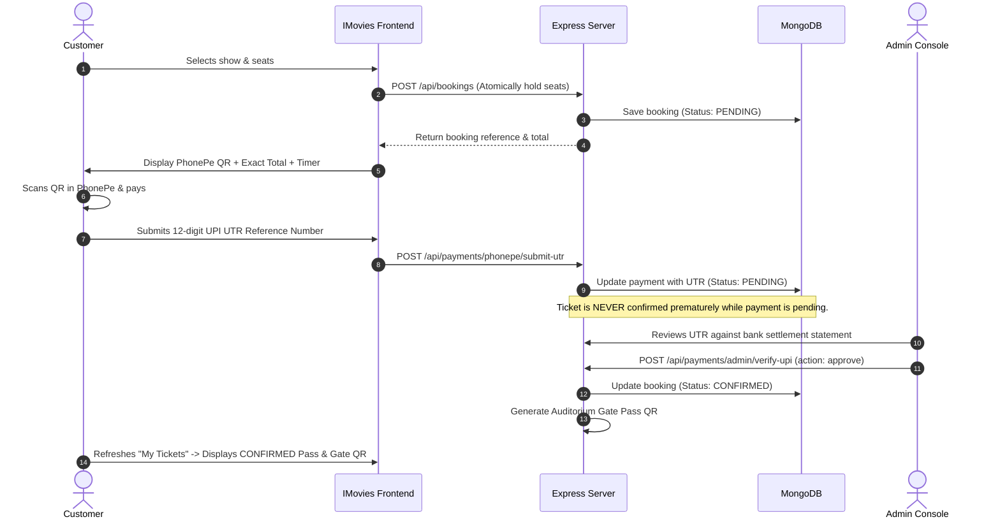

# 🎬 IMovies — Full-Stack Movie Ticket Booking Website

[](https://nodejs.org/)
[](https://react.dev/)
[](https://tailwindcss.com/)
[](https://expressjs.com/)
[](https://mongoosejs.com/)

A cinematic, responsive, full-stack movie ticket booking web application built with the **MERN** stack (MongoDB, Express, React, Node.js). Inspired by modern cinema experiences (IMAX, Dolby Atmos, BookMyShow), **IMovies** features real-time seat availability, concurrency-safe seat locking, city-based multi-theatre discovery, PhonePe UPI QR and Razorpay payment checkout, "My Tickets" QR passes, and an integrated Admin Management Console.

---

## 🌟 Key Features

### 1. Home & Movie Discovery
- **Hero Carousel Banner**: Showcases featured blockbuster premieres (*The Odyssey*, *Dhurandhar*, *Interstellar Echoes*) with trailers and quick booking actions.
- **Popular Movies Ranking**: Curated sample leaderboard highlighting trending films with transparent, clearly labeled demo rankings.
- **City Selector**: Choose between top cinema hubs (**Mumbai, Delhi-NCR, Bengaluru, Hyderabad, Chennai, Kolkata, Pune**) with dynamic showtime and cinema updates.
- **Multi-Filter & Search Engine**: Real-time filtering by Genre (Action, Sci-Fi, Thriller, Comedy, etc.), Language (English, Hindi, Tamil, Telugu), and Status (Now Showing, Upcoming), plus instant text search across titles, cast, and directors.

### 2. In-App Movie Details & Seating Selection
- **Single-Page In-App Booking**: Opens full movie details, trailers, cast avatars, and showtimes directly without opening new browser tabs.
- **Multi-Tier Interactive Seating Map**:
  - Curved glowing Cinema Screen perspective.
  - Tiers: **Classic, Premium, VIP, and Recliner** with distinct pricing.
  - Aisle spacing (columns 1–4, 5–8, 9–12).
  - Real-time seat statuses: **Available, Selected, and Booked / Sold**.
  - **Server-Side Concurrency Locking**: Atomic seat validation prevents double-booking if two users select the same seat simultaneously.
  - Live cost breakdown updating instantly with ticket prices and convenience fees.

### 3. Authentication & Account Security
- **JWT & Bcrypt**: Passwords securely hashed with `bcryptjs` (salt rounds 10) on the server; plain-text passwords are never stored.
- **Protected Routes & APIs**: Users can only access and cancel their own bookings and update their own profiles.
- **Modern Accessible Validation**: Input validation following modern platform standards (`:user-invalid` / `:user-valid`) with clear feedback.
- **Built-in Rate Limiting**: `express-rate-limit` protects authentication endpoints (login, register) and booking checkout APIs against brute-force attacks.

### 4. Checkout & Multi-Rail Payments
- **PhonePe UPI QR Experience**:
  - Displays high-resolution PhonePe QR code with merchant VPA (`imovies.ticket@phonepe`), merchant name, and exact amount due.
  - 10-minute seat hold countdown timer.
  - One-click UPI ID copy button.
  - **Transparent Payment Notice**: Explains clearly that scanning a static QR code does not automatically inform the website whether the payment succeeded.
  - **12-digit UPI UTR Submission**: Customers submit their bank reference / UTR for server-side reconciliation and verification.
- **Razorpay Gateway Integration**:
  - Full client and server integration.
  - Secret keys kept strictly on the backend; orders created via Razorpay SDK and verified cryptographically using HMAC-SHA256 signatures.
- **Isolated Demo Sandbox Mode**:
  - Explicitly labeled for demonstration, testing, and grading.
  - Separately tests **Simulate Success** (confirms booking and generates ticket QR) and **Simulate Decline** (cancels booking and frees up seats).

### 5. My Tickets & Gate Pass
- Dedicated "My Tickets" dashboard for signed-in users.
- Boarding-pass cinematic ticket design with movie artwork, auditorium screen type, date, time, and seat numbers.
- **Strict Payment Status Segregation**: Never shows a ticket as confirmed while payment is pending.
- Scannable **Auditorium Gate QR code** generated only for confirmed bookings.
- One-click **Print Ticket** action.

### 6. Admin Management Console
- Protected console accessible to administrators (`admin@imovies.com`).
- **Real-Time KPI Metrics**: Total Gross Revenue, Confirmed Tickets, Pending Orders, and Active Movies.
- **Booking & UPI Reconciliation**: Review customer submitted UTR references with 1-click **Approve** (confirms pass and generates ticket QR) or **Reject** (cancels and frees seats).
- **Movies Catalog**: Add new films with poster/banner URLs, durations, and certificates, or delete films.
- **Show Scheduler**: Schedule auditorium showtimes for any movie, cinema, screen format, and tier pricing.

---

## 🏗️ Project Architecture

```
IMOVIES/
├── backend/
│   ├── config/
│   │   ├── db.js               # Dual-mode DB: MongoDB Atlas or built-in In-Memory MongoDB
│   │   └── razorpay.js         # Razorpay client & HMAC signature validator
│   ├── controllers/
│   │   ├── authController.js    # Register, login, getMe, updateProfile
│   │   ├── movieController.js   # Movies discovery, filters, search, rankings
│   │   ├── cinemaController.js  # Cinemas and cities listing
│   │   ├── showController.js    # Shows and seating availability
│   │   ├── bookingController.js # Concurrency-safe seat reservation & my-tickets
│   │   └── paymentController.js # PhonePe UTR submission, Razorpay, and Demo sandbox
│   ├── middleware/
│   │   ├── auth.js             # JWT bearer authentication
│   │   ├── admin.js            # Admin role guard
│   │   ├── errorHandler.js     # Centralized error handler
│   │   └── rateLimiter.js      # Rate limiting on auth & bookings
│   ├── models/
│   │   ├── User.js             # User account schema with password hashing
│   │   ├── Movie.js            # Movie metadata, genres, ratings, rankings
│   │   ├── Cinema.js           # Theatres, cities, facilities
│   │   ├── Show.js             # Showtimes, pricing tiers, booked seat entries
│   │   ├── Booking.js          # Booking reference, seats, totals, status
│   │   └── Payment.js          # Payment transaction, method, UTR, signatures
│   ├── routes/                 # Express API routes
│   ├── seed/
│   │   ├── seedData.js         # Curated movies (The Odyssey, Dhurandhar, etc.), 11 cinemas
│   │   └── seeder.js           # Auto-seeder generating 1,155 shows with realistic bookings
│   ├── utils/
│   │   └── qrGenerator.js      # Generates SVG/DataURI ticket gate QR passes
│   ├── .env.example
│   ├── package.json
│   └── server.js               # Express application entry point & static SPA server
│
├── frontend/
│   ├── public/
│   │   ├── phonepe-qr.svg      # Authentic PhonePe UPI QR graphic
│   │   └── imovies-logo.svg    # IMovies logo graphic
│   ├── src/
│   │   ├── components/
│   │   │   ├── booking/        # SeatMap, BookingSummaryBar
│   │   │   ├── checkout/       # CheckoutModal (PhonePe, Razorpay, Sandbox)
│   │   │   ├── common/         # Navbar, Footer, AuthModal, CitySelectorModal
│   │   │   ├── home/           # HeroBanner, MovieFilters, MovieCard, PopularRanking
│   │   │   ├── movie/          # DateSelector, ShowtimesList
│   │   │   └── tickets/        # TicketCard with gate QR
│   │   ├── context/            # AuthContext, CityContext, ToastContext
│   │   ├── pages/              # HomePage, MovieDetailsPage, MyTicketsPage, ProfilePage, AdminPage
│   │   ├── services/           # API fetch client wrapper
│   │   ├── App.jsx
│   │   └── main.jsx
│   ├── package.json
│   ├── vite.config.js
│   └── tailwind.config.js
│
├── package.json                # Root orchestration scripts
├── start-full.js               # Dual-process runner
└── README.md
```

---

## 🚀 Quick Start Guide

### Prerequisites
- [Node.js](https://nodejs.org/) v18.0.0 or higher.
- (Optional) [MongoDB Atlas](https://www.mongodb.com/cloud/atlas) or a local MongoDB server. **If you don't have MongoDB installed, the application automatically boots with a built-in In-Memory MongoDB server for instant zero-configuration testing!**

### 1. Clone & Install Dependencies

From the project root directory:

```bash
# Install backend dependencies
cd backend
npm install

# Install frontend dependencies
cd ../frontend
npm install

# Return to root
cd ..
```

### 2. Configure Environment Variables

Copy the example environment file:

```bash
# In the backend directory:
cp backend/.env.example backend/.env
```

Default `backend/.env` contents:
```env
PORT=5000
NODE_ENV=development

# Leave blank to use the built-in in-memory MongoDB automatically:
MONGODB_URI=

# JWT Secret for sessions
JWT_SECRET=imovies_super_secret_jwt_key_2026_cinematic

# Optional: Razorpay Keys (Leave empty to use PhonePe QR / Demo Sandbox)
RAZORPAY_KEY_ID=
RAZORPAY_KEY_SECRET=

PHONEPE_MERCHANT_VPA=imovies.ticket@phonepe
PHONEPE_MERCHANT_NAME=IMOVIES ENTERTAINMENT PVT LTD
```

### 3. Run the Application

You can launch the full-stack application using either method:

#### Option A: Unified Full-Stack Server (Single Port 5000)
Build the frontend once, then run the Express server which serves both the API and the React frontend:

```bash
npm run build
npm start
```
Open **[http://localhost:5000](http://localhost:5000)** in your browser!

#### Option B: Hot-Reloading Development Mode
Run the backend API and Vite dev server simultaneously:

```bash
# Terminal 1 (Backend API on port 5000):
npm run dev:backend

# Terminal 2 (Vite Frontend on port 5173):
npm run dev:frontend
```
Open **[http://localhost:5173](http://localhost:5173)** in your browser! (Vite automatically proxies `/api` requests to `http://localhost:5000`).

---

## 🔑 Demo Accounts (Pre-Seeded)

The database automatically seeds on first launch with 8 films, 11 multi-city cinemas, 1,155 shows, and test user accounts:

| Role | Email | Password | Permissions |
| :--- | :--- | :--- | :--- |
| **Administrator** | `admin@imovies.com` | `AdminPassword123!` | Full Admin Console, movie editing, show scheduling, payment approval |
| **Demo Customer** | `demo@imovies.com` | `Password123!` | Movie discovery, seat bookings, My Tickets, profile updates |

> **Tip:** The sign-in modal includes **One-Click Demo Credentials** buttons to instantly fill and sign in as either Admin or Customer.

---

## 💳 Payment Architecture & PhonePe UPI Workflow

### Why Static QR Scanning Requires Server Verification
A static UPI QR code encodes a UPI payment URI (such as `upi://pay?pa=...&am=...&tr=...`). Scanning this QR code inside an app like PhonePe or Google Pay triggers a transaction between the user's bank and the merchant's bank account. **The mobile banking app communicates with the NPCI/bank network, not directly with our website.**

Because a static QR code cannot send client-side web callbacks, the booking confirmation follows an industry-standard, fraud-resistant pattern:



### Razorpay Integration
When `RAZORPAY_KEY_ID` and `RAZORPAY_KEY_SECRET` are provided in `.env`:
1. The frontend requests an order ID via `POST /api/payments/razorpay/create-order`.
2. The server initializes the order with the official Razorpay SDK, keeping secret keys on the backend.
3. Razorpay's checkout modal launches in the browser.
4. On completion, the frontend sends the returned `razorpay_payment_id`, `razorpay_order_id`, and `razorpay_signature` to `POST /api/payments/razorpay/verify`.
5. The server computes the HMAC-SHA256 signature and verifies authenticity before confirming the ticket.

### Demo Sandbox Mode
For immediate evaluation without live payment keys, select the **Demo Sandbox** tab in checkout:
- **Simulate Success**: Confirms the booking, assigns payment verification records, and generates the gate QR code.
- **Simulate Decline**: Cancels the booking and immediately frees held seats back to the seating map.

---

## 🚢 Deployment Guidance

### ⚠️ Why Static Hosts (e.g. GitHub Pages) Cannot Run this Application
Platforms like **GitHub Pages**, Cloudflare Pages (pure static), and AWS S3 static hosting serve **only static HTML, CSS, and client-side JavaScript**. They **do not have a Node.js runtime environment** and cannot execute:
- The Express.js backend server.
- Database queries and connections to MongoDB.
- Cryptographic password hashing (`bcryptjs`) and JWT token verification.
- Concurrency-safe atomic seat reservations.
- Razorpay server-side signature validation.

Attempting to deploy this repository solely to GitHub Pages will cause all `/api` calls to fail with 404 errors.

### Recommended Full-Stack Deployment Architecture

#### Option 1: Render (Recommended & Simplest)
1. Push your repository to GitHub.
2. Sign up at [Render.com](https://render.com/).
3. Create a **Web Service** pointing to your repository.
4. Settings:
   - **Environment**: `Node`
   - **Build Command**: `npm run build`
   - **Start Command**: `npm start`
5. Environment Variables:
   - `NODE_ENV`: `production`
   - `MONGODB_URI`: Your MongoDB Atlas connection string (`mongodb+srv://...`)
   - `JWT_SECRET`: A secure random 32+ character string
   - `PORT`: `5000` (or leave default for Render to inject)

#### Option 2: Railway or Fly.io
Deploy the repository as a Node.js web process with a managed MongoDB database plugin or MongoDB Atlas.

#### Option 3: Decoupled (Vercel Frontend + Render Backend)
- Deploy the `/backend` directory to **Render** or **Railway**.
- Deploy the `/frontend` directory to **Vercel**, setting the `VITE_API_BASE_URL` to your Render API URL.

---

## 🛠️ Technology Stack

- **Frontend**: React 18, Vite 5, Tailwind CSS 3, Lucide React icons, Canvas Confetti.
- **Backend**: Node.js 20, Express 4.21, Mongoose 8, JWT, Bcryptjs, Express Rate Limit, QRCode, Razorpay SDK.
- **Database**: MongoDB (supporting In-Memory Embedded Mode and MongoDB Atlas).

---

## 📄 License
This project is open-source and available under the [ISC License](LICENSE).
# IMovies---Watch-Movies

# IMovies---Watch-Movies

# IMovies---Watch-Movies

